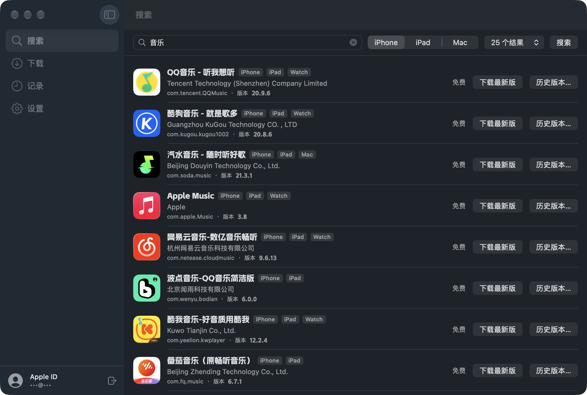
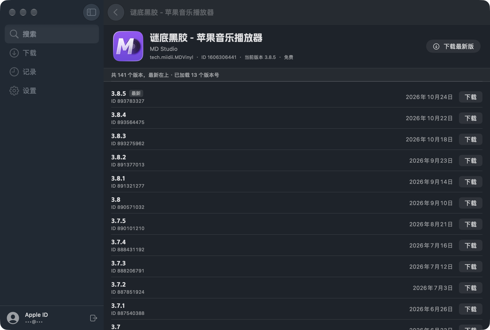
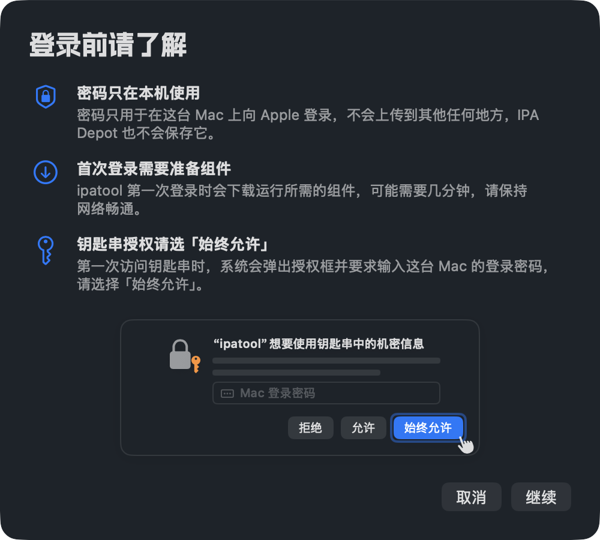

# IPA Depot

**IPA Depot 是一个 macOS 原生图形界面工具：登录你的 Apple ID，搜索 App Store，下载 App 的最新版或任意历史版本 IPA。**底层调用内置的 [ipatool](https://github.com/majd/ipatool) v2.7.0（MIT），不需要打开终端。

[下载最新版](https://github.com/OWNER_PLACEHOLDER/ipa-depot/releases/latest) · 系统要求：macOS 14 Sonoma 或更新，Apple 芯片与 Intel 通用

| 搜索 | 历史版本 | 登录前的准备页 |
|---|---|---|
|  |  |  |

## 功能

- **登录 / 登出 Apple ID**：登录前先显示准备页，说明密码用途、首次组件下载与钥匙串授权；支持双重认证 6 位验证码。密码通过伪终端直接交给 ipatool，不进命令行参数、不写日志、不保存。
- **首次启动不碰钥匙串**：第一次登录成功之前，App 启动时不会读取钥匙串，所以不会在你看到说明之前就弹出系统授权框。
- **搜索 App**：按 iPhone / iPad / Mac 平台搜索账号所在地区的 App Store，显示图标、开发者、Bundle ID、当前版本、价格与平台。
- **历史版本**：列出全部历史版本（最新在上），版本号与发布日期按需加载并缓存，任一版本都能下载。
- **下载队列**：一次下载一个，其余排队；显示进度、大小与速度；可暂停、继续（断点续传）、取消。排队中与已暂停的任务在退出后保留，下次打开恢复为「已暂停」，点继续即可接着下载。
- **领取免费 App**：免费 App 还没加入你的账号时，可以一键领取免费许可后下载。
- **下载记录**：名称、版本、大小、路径、完成时间；文件被移走后会灰显；可在访达中显示。
- **设置**：下载目录（默认 `~/Downloads/IPA Depot`）、缓存清理（只清本 App 的缓存）、关于与许可、检查更新（GitHub Releases）。
- 简体中文界面，附英文界面（跟随系统语言）。

## 安装与首次打开

IPA Depot 没有 Apple 开发者签名，也没有经过 Apple 公证（这需要每年 99 美元的开发者会员）。第一次打开时 macOS 会拦一下，按下面的步骤放行一次即可，以后正常打开。

1. 从 [Releases](https://github.com/OWNER_PLACEHOLDER/ipa-depot/releases/latest) 下载 `IPA-Depot-<版本>-macos-universal.dmg`（或 `.zip`）。
2. 打开 dmg，把 **IPA Depot** 拖进「应用程序」文件夹。
3. 在「应用程序」里双击打开 IPA Depot。系统会提示无法验证开发者，点「完成」（不要点「移到废纸篓」）。
4. 打开 **系统设置 › 隐私与安全性**，往下拉到「安全性」一栏，会看到「已阻止打开 IPA Depot」，点 **「仍要打开」**，按提示输入 Mac 登录密码。
5. 再次打开 IPA Depot，在弹出的确认框里点 **「打开」**。之后就和普通 App 一样了。

**如果提示「IPA Depot 已损坏，无法打开」**（这种情况下系统设置里不会出现「仍要打开」），打开「终端」执行下面这一行，然后重新打开即可：

```sh
xattr -dr com.apple.quarantine "/Applications/IPA Depot.app"
```

这条命令只是去掉 macOS 给网上下载文件加的「隔离」标记，不修改 App 本身。

**首次登录时会发生两件事：**

- **下载运行组件**：ipatool 第一次登录或下载时，会从网上下载它需要的运行组件（约 56 MB，存放在 `~/Library/Caches/ipatool`），可能需要几分钟，请保持网络畅通。
- **钥匙串授权**：ipatool 把登录信息保存在你的「登录」钥匙串里。第一次访问时系统会弹出「ipatool 想要使用钥匙串中的机密信息」，并要求输入这台 Mac 的登录密码，请选择 **「始终允许」**。如果只点了「允许」，之后每次访问都会再问一次。IPA Depot 更新到新版本后，系统可能会再询问一次。

## 使用说明

- **登录**：点左下角「登录」→ 阅读准备页后点「继续」→ 输入 Apple ID 和密码。开启了双重认证的账号，会在你的 Apple 设备上收到 6 位验证码，填进弹出的输入框即可。
- **搜索**：在「搜索」页输入 App 名称或关键词，选择平台（iPhone / iPad / Mac）和结果数量。搜索的是**你账号所在地区**的 App Store。
- **历史版本**：在搜索结果里点「历史版本…」，列表最新的在上面；版本号与日期会随着滚动陆续加载，点任一行的「下载」即可。
- **下载**：点「下载最新版」或历史版本的「下载」后，任务进入「下载」页。可以暂停、继续、取消；完成后点「在访达中显示」找到 IPA 文件。文件名格式为 `名称_版本.ipa`，同名时自动加序号。
- **记录**：「记录」页保存已完成的下载，移除记录不会删除文件。
- **设置**：修改下载目录、查看与清理缓存、查看版本与许可、检查更新。

## 网络说明

IPA Depot 的所有网络请求都由 ipatool 直接发往 Apple 与组件下载站，不经过任何第三方服务器。在**中国大陆网络**下，以下域名有时连接不稳定或无法直连：

- Apple 的购买 / 下载接口，例如 `p*-buy.itunes.apple.com`，以及 App 安装包所在的 Apple CDN；
- `files.pythonhosted.org`：首次准备组件时下载 unicorn 运行库；
- `swcdn.apple.com`：首次准备组件时读取 Apple 组件。

如果遇到「网络连接中断」「unexpected EOF」或首次准备组件一直不动，建议开启可靠的代理（全局或规则模式包含上述域名）后重试。下载中断不要紧，点「继续」会从断点接着下载。

## 常见问题

**提示「license is required」/ 该 App 尚未加入你的账号**
这个 App 还不在你的账号「已购项目」里。免费 App 可以在提示框里点「领取并下载」，IPA Depot 会先领取免费许可再下载；付费 App 需要先在 App Store 购买。

**提示「password token is expired」/ 登录已过期**
Apple 让登录凭据失效了。登出后重新登录即可。

**提示「account is disabled」/ 账号被停用**
这是 Apple 对账号的限制，与 IPA Depot 无关。请到 [Apple 账户网站](https://account.apple.com) 或联系 Apple 支持处理。

**双重认证收不到验证码 / 验证失败**
验证码会推送到登录了同一 Apple ID 的 iPhone、iPad 或 Mac 上。验证码只能输两次，失败后请关闭登录窗口重新登录，等新的验证码到了再输。

**搜不到某个 App，或者结果和手机上不一样**
搜索和下载都跟随**账号所在地区**的 App Store。例如中国区账号搜不到只在美区上架的 App。

**下载中断了怎么办**
在「下载」页点「继续」，会从已下载的部分接着下（未完成的数据保存在下载目录里的 `<文件名>.ipa.tmp`）。退出 App 时未完成的任务会保留，下次打开恢复为「已暂停」。点「取消」会删除这个未完成的文件。

**提示「找不到钥匙串」**
你的 Mac 用户可能没有默认钥匙串。打开「钥匙串访问」，确认「登录」钥匙串存在并设为默认后重试。

## 免责与使用边界

- IPA Depot 只能下载**你的账号已经拥有**、或者**可以免费领取**的 App。
- 付费 App 必须先在 App Store 用同一个 Apple ID 购买。
- 请遵守 Apple 的媒体服务条款与所在地区的法律法规。使用本工具产生的一切后果（包括账号被限制）由使用者自行承担。
- 本项目**不提供、也不会提供**任何破解、解密、绕过付费或绕过 DRM 的功能。下载得到的 IPA 与从 App Store 获取的完全相同，仍受 FairPlay 保护。
- IPA Depot 与 Apple Inc. 没有任何关联。App Store、Apple ID 是 Apple Inc. 的商标。

## 致谢

- [majd/ipatool](https://github.com/majd/ipatool)：MIT 许可，Copyright (c) 2021 Majd Alfhaily。IPA Depot 内置其官方 Release 二进制（arm64 与 amd64 合并为 universal，sha256 锁定），许可全文见 `vendor/ipatool/LICENSE`，随 App 打包为 `Contents/Resources/ipatool-LICENSE`。
- [阿里妈妈数黑体](https://fonts.alibabagroup.com)：标题与数字字体，由淘宝（中国）软件有限公司提供，可免费商用。法律声明原文见 `App/Resources/Fonts/阿里妈妈数黑体-许可.txt`（随 App 打包在 `Contents/Resources/Fonts/`）。**字体不在本项目 MIT 许可范围内**，使用须遵守其法律声明。
- [a23bc/ipatool-gui](https://github.com/a23bc/ipatool-gui)：调研中参考了它的交互设计（进度解析、`.tmp` 兜底、网络提示等），IPA Depot 没有使用它的代码。

## 开发

```sh
brew install xcodegen
scripts/fetch-ipatool.sh          # 拉取并校验 ipatool，合并为 universal → vendor/ipatool/ipatool
xcodegen generate
xcodebuild -scheme IPADepot -configuration Debug -derivedDataPath build/DerivedData build
xcodebuild test -scheme IPADepotCore -derivedDataPath build/DerivedData
```

- 发布包：`scripts/build-release.sh`（universal Release 构建 → ad-hoc 签名 → `build/release/` 下的 zip、dmg 与 sha256），完整步骤见 `docs/RELEASING.md`。
- 仓库地址：`scripts/set-owner.sh <GitHub 用户名>` 一次性填写 `App/Logic/ProjectInfo.swift` 的 owner 与本 README 的链接。
- 图标：`swift scripts/make-app-icon.swift App/Assets.xcassets/AppIcon.appiconset`（CoreGraphics 程序化生成）。
- 本地化：构建一次后运行 `python3 -I scripts/sync-strings.py --check`，检查 `App/Localizable.xcstrings` 是否有新 key 或缺英文。
- Debug 构建可用环境变量 `IPADEPOT_IPATOOL_PATH` 指定 ipatool、`IPADEPOT_DATA_ROOT` 指定数据目录（Release 构建忽略二者，只用内置 ipatool）。
- 数据位置：`~/Library/Application Support/IPA Depot/`（`history.json` 下载记录、`queue.json` 未完成的下载队列、`cache/` 本 App 缓存、`state/` ipatool 状态目录）。
- CI：`.github/workflows/ci.yml`（push / PR 构建与测试）、`.github/workflows/release.yml`（推送 `v*` 标签时构建并上传到 GitHub Release 草稿）。

## 许可

IPA Depot 以 [MIT 许可](LICENSE) 发布。内置的 ipatool 为 MIT 许可；阿里妈妈数黑体按其自身法律声明授权，不在 MIT 范围内。

---

## English

**IPA Depot** is a native macOS app for signing in with your Apple ID, searching the App Store, and downloading the latest or any previous version of an app as an IPA. It wraps the bundled [ipatool](https://github.com/majd/ipatool) 2.7.0 (MIT) — no Terminal required. Requires macOS 14 or later (universal: Apple silicon and Intel).

The app is ad-hoc signed and not notarized. On first launch, open it once, then go to **System Settings › Privacy & Security** and click **Open Anyway**. If macOS says the app "is damaged", run `xattr -dr com.apple.quarantine "/Applications/IPA Depot.app"`. The first sign-in downloads ipatool's runtime components and asks for keychain access — choose **Always Allow**.

You can only download apps your account already owns or free apps you can claim; paid apps must be purchased in the App Store first. IPA Depot provides no cracking, decryption or DRM circumvention, and is not affiliated with Apple Inc. Released under the MIT License; the bundled Alimama ShuHeiTi font is licensed separately under its own legal notice.
